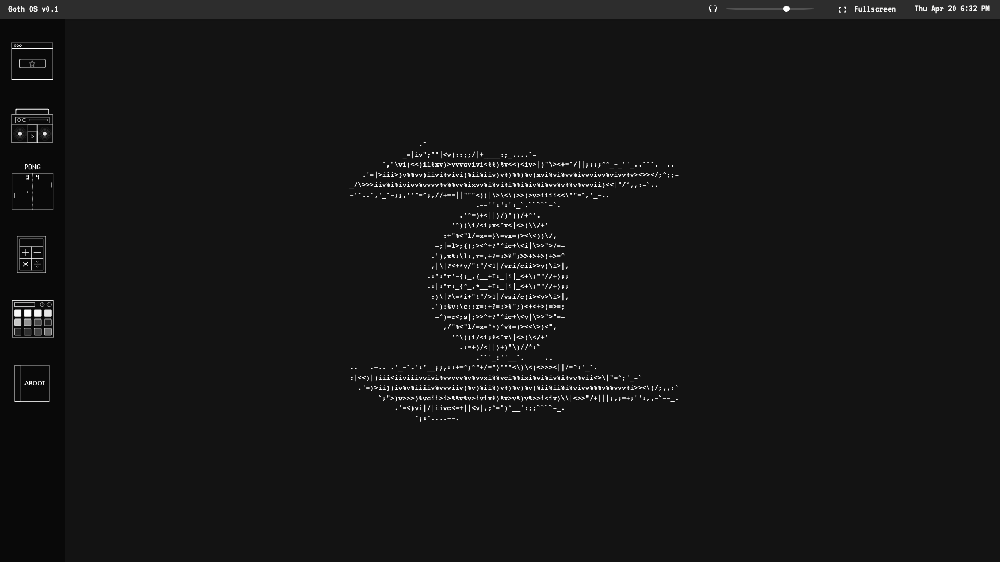

# Goth OS

A retro desktop-themed portfolio site. Apps open in draggable, resizable windows over an animated ASCII background: an about page, a web browser, Pong, 3D Space Invaders (a Three.js port of the Java/JOGL original), Yukon's Gold (a gold-mining RTS embedded from its own deployment), a calculator, a music player, and a groove box.

**Live:** https://kylegothman.github.io/goth-os/



## Tech stack

- React 18 + TypeScript
- Vite
- Tailwind CSS 3
- react-draggable for window movement (resizing is pointer-event based, in `Window.tsx`)
- Deployed to GitHub Pages

## Getting started

```bash
git clone https://github.com/kylegothman/goth-os.git
cd goth-os
npm install
npm run dev
```

The dev server runs at http://localhost:5173/goth-os/ (the site is served under the `/goth-os/` base path to match GitHub Pages).

## Scripts

| Command             | What it does                                   |
| ------------------- | ---------------------------------------------- |
| `npm run dev`       | Start the Vite dev server                      |
| `npm run build`     | Type-check and build to `dist/`                |
| `npm run preview`   | Serve the production build locally             |
| `npm run typecheck` | Run the TypeScript compiler without emitting   |
| `npm run deploy`    | Build and publish `dist/` to GitHub Pages      |

## Analytics (optional)

Copy `.env.example` to `.env.local` and set `VITE_GA_MEASUREMENT_ID` to a GA4 measurement ID. Analytics stay off while it is empty. `npm run deploy` builds locally, so the ID in `.env.local` is what ships.

## Adding an app

Register it in `src/apps.config.tsx` with an id, title, dock icon, the screen component and an optional `defaultWindowSize`. Screens receive `WindowFocusContext` (true while their window is front-most) and should read the site volume from `VolumeContext` if they make sound — embedded pages get it by message, see `docs/embedded-audio.md`.

## Project layout

```
src/
  apps.config.tsx     # registry of apps shown in the dock
  assets/fonts/       # self-hosted fonts (VT323, Gotham)
  components/
    screens/          # Desktop, Navbar, SideBar
    base/             # Window, SideBarApp, GothApp
    apps/             # one file or folder per app
    icons/            # inline SVG dock icons
    utils/            # Clock, Volume, Status
public/
  assets/             # ASCII animation frames, icons
  files/              # resume PDF
docs/                 # content hand-off and integration notes
```

## Future plans

- Background picker for the other ASCII animation sets
- Additional apps
- Ongoing UI refinements

## License

The code is licensed under the MIT License — see [LICENSE](LICENSE).

Fonts are licensed separately and are not covered by the MIT license: VT323 is under the SIL Open Font License; the Ubuntu Font Family is under the Ubuntu Font Licence 1.0 (`src/assets/fonts/ubuntu/UFL.txt`); Gotham is a commercial typeface used under its own license.
